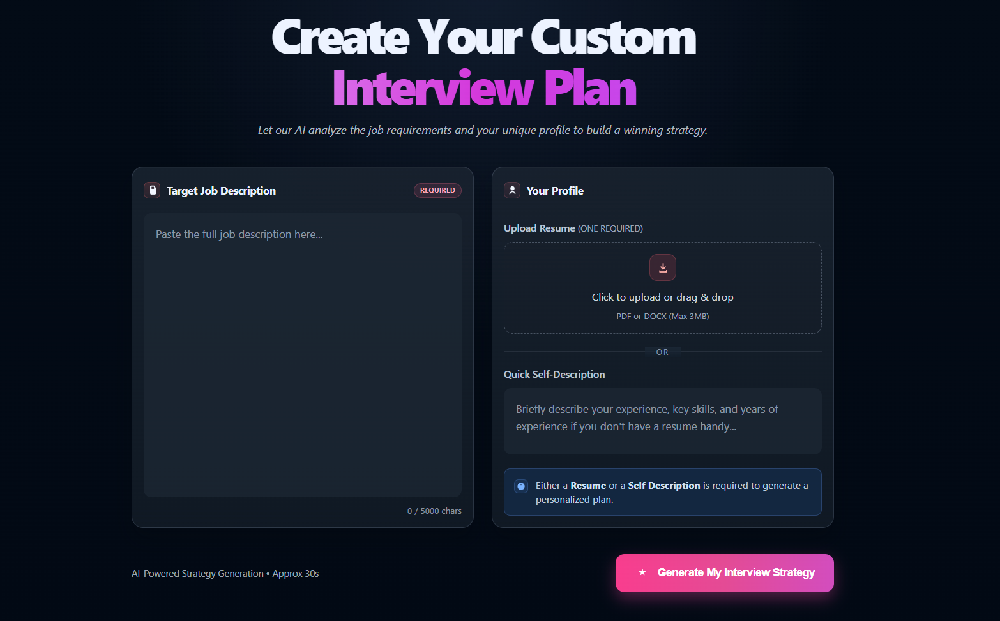
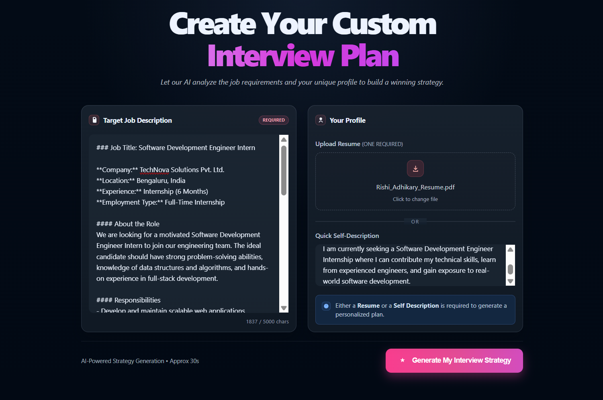
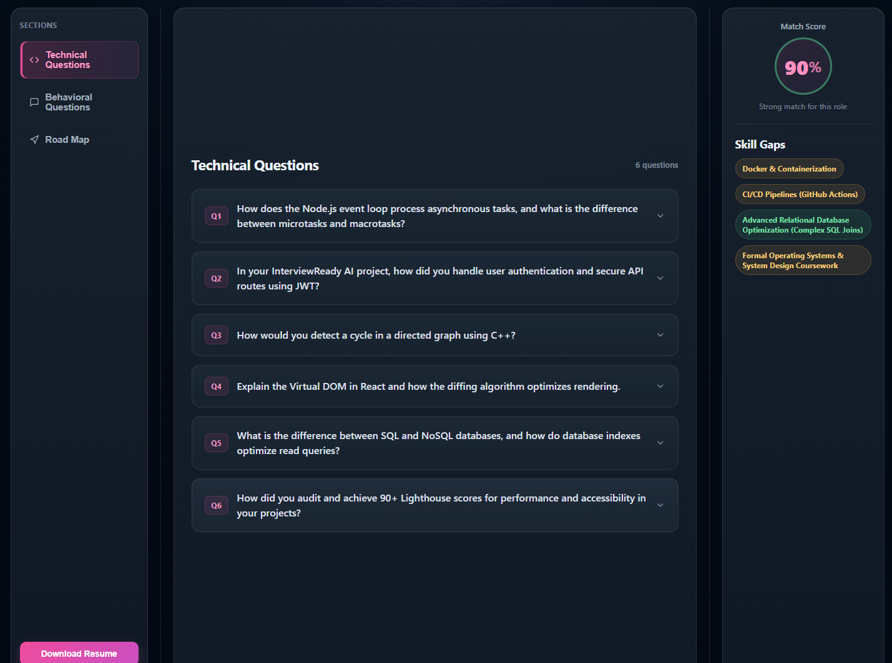
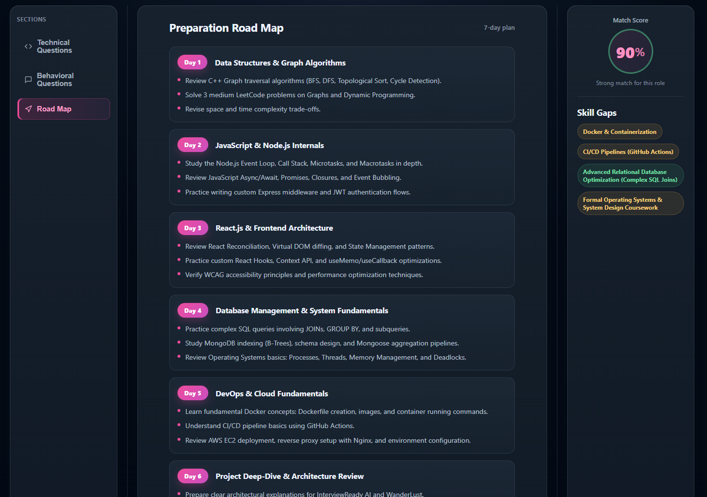
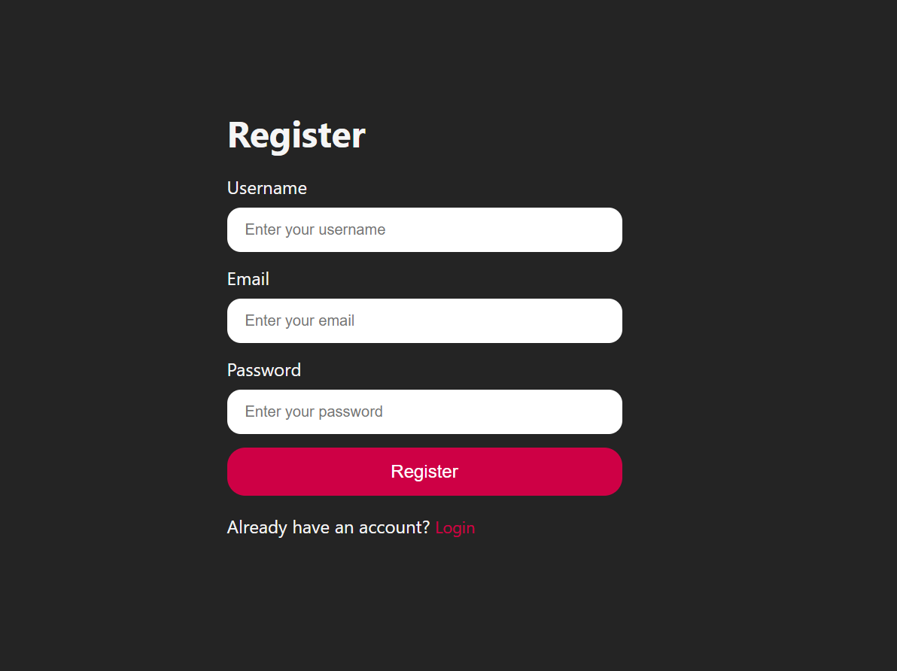
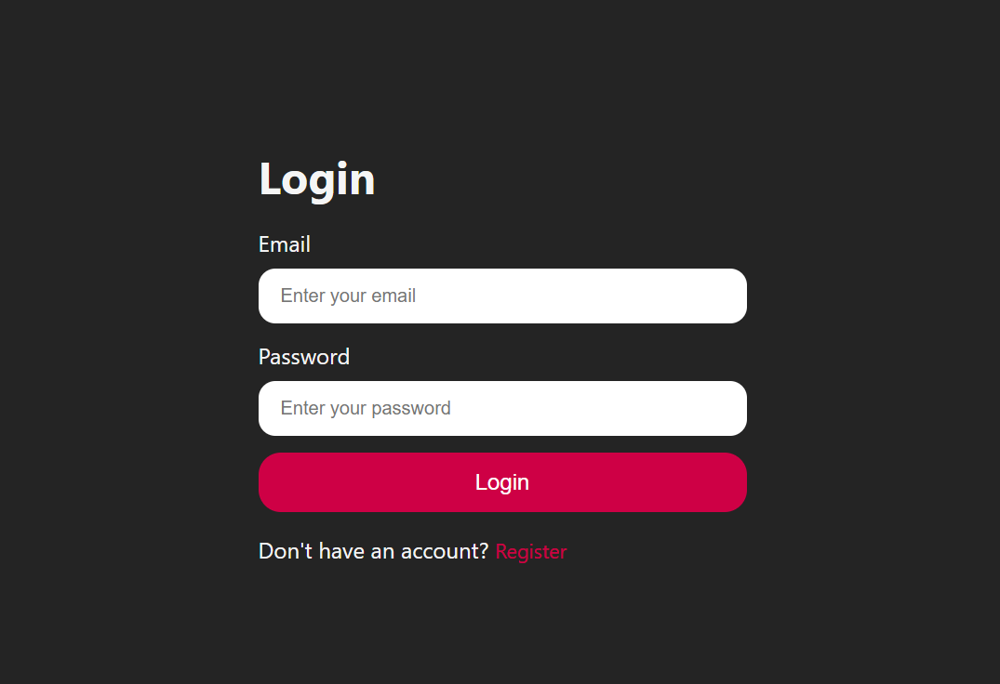

[README.md](https://github.com/user-attachments/files/34674235/README.md)
# InterviewReady AI

An AI-powered interview preparation platform that analyzes a candidate's resume or self-description against a target job description and generates a personalized interview preparation strategy.

InterviewReady AI helps candidates understand how closely their profile matches a role, identify skill gaps, practise technical and behavioral questions, and follow a focused preparation roadmap.

<!-- Replace the links below with your actual deployed URLs and repository URL. -->
**Live Demo:** `Add your live application URL`  
**Backend/API:** `Add your backend URL if publicly available`

---

## Screenshots

### Create a personalized interview plan
Provide a target job description and either upload a resume (PDF/DOCX) or enter a short self-description.



### Generate interview strategy
The platform uses the job requirements and candidate profile to create a tailored preparation strategy.



### Technical interview questions
Review role-specific technical questions generated from the candidate profile and job requirements.



### Personalized preparation roadmap
Follow a structured, seven-day preparation plan with topics and concrete tasks.



### Authentication
Users can create an account and sign in to access the application.

| Register | Login |
|---|---|
|  |  |

---

## Features

- **Resume or self-description input:** Upload a PDF/DOCX resume or provide a written profile.
- **Job description analysis:** Use a target job description as the basis for personalized preparation.
- **Profile-to-role match score:** Display an AI-generated match score and an indication of role alignment.
- **Skill-gap identification:** Highlight skills and knowledge areas that may need more preparation.
- **Technical questions:** Generate technical interview questions relevant to the target role.
- **Behavioral questions:** Prepare for behavioral and HR interview rounds.
- **Preparation roadmap:** Generate a structured seven-day plan with daily topics and tasks.
- **Resume download:** Access the resume download action from the preparation interface.
- **User authentication:** Register and log in to the platform.

## How It Works

1. Register or log in.
2. Paste the target job description.
3. Upload a resume in PDF/DOCX format or enter a self-description.
4. Generate the interview strategy.
5. Review the match score and identified skill gaps.
6. Practise the generated technical and behavioral questions.
7. Follow the preparation roadmap.

## Technology Stack

> Update this section if your implementation uses different libraries or services.

| Layer | Technology |
|---|---|
| Frontend | React.js, Vite |
| Backend | Node.js, Express.js |
| Database | MongoDB |
| AI integration | Google Gemini API |
| API communication | Axios / Fetch |
| Deployment | Add your hosting providers |

## Lighthouse Scores

The reported Lighthouse audit results for InterviewReady AI are:

| Category | Score |
|---|---:|
| Performance | **100** |
| Accessibility | **93** |
| Best Practices | **96** |
| SEO | **96** |

Scores can vary depending on the audit environment, device emulation, network conditions, and the page being tested. These values represent the results reported for the project at the time of the audit.

## Getting Started

The commands below are a general setup outline. Confirm the actual folder names and npm scripts in your repository before running them.

### Prerequisites

- Node.js and npm
- A MongoDB database, if the backend uses MongoDB
- An AI provider API key, if required by the backend

### 1. Clone the repository

```bash
git clone <YOUR_GITHUB_REPOSITORY_URL>
cd <YOUR_PROJECT_DIRECTORY>
```

### 2. Install dependencies

If your project has separate frontend and backend folders:

```bash
cd backend
npm install

cd ../frontend
npm install
```

### 3. Configure environment variables

Create the required `.env` files based on the variables read by your application. For example:

```env
# Backend examples — use the exact variable names from your code
MONGO_URI=your_mongodb_connection_string
JWT_SECRET=your_jwt_secret
GOOGLE_GENAI_API_KEY=your_gemini_api_key
```

Do not commit real credentials or `.env` files. Add a sanitized `.env.example` file to document the required variable names.

### 4. Run the application

Use the scripts defined in each `package.json`. A common Vite frontend command is:

```bash
npm run dev
```

Start the backend with the development script configured in its `package.json` (for example, `npm run dev`).

## Project Structure

The exact structure may differ depending on your repository:

```text
InterviewReady-AI/
├── frontend/
│   ├── src/
│   ├── public/
│   └── package.json
├── backend/
│   ├── routes/
│   ├── controllers/
│   ├── models/
│   └── package.json
├── assets/
│   └── screenshots/
└── README.md
```

## Future Enhancements

- Interactive mock interviews with follow-up questions.
- Voice-based interview practice.
- AI-generated feedback on spoken or written answers.
- Progress tracking across multiple preparation sessions.
- More detailed resume improvement recommendations.

## Contributing

Contributions and suggestions are welcome.

1. Fork the repository.
2. Create a feature branch.
3. Commit your changes.
4. Push the branch.
5. Open a pull request.

## Author

**Rishi Adhikary**  
B.Tech, Mechanical Engineering — NIT Durgapur

- GitHub: [rishiadhikary](https://github.com/rishiadhikary)
- LinkedIn: Add your LinkedIn profile URL

---

If you find this project useful, consider giving the repository a star.
